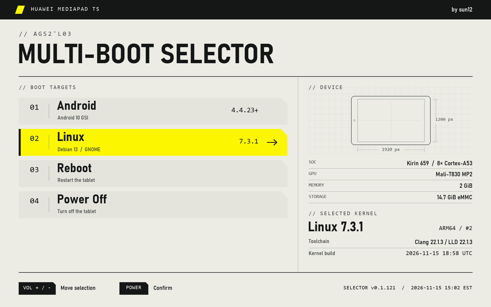

# Huawei MediaPad T5 Linux

Huawei MediaPad T5 **AGS2-L03，2 GiB RAM** 的 Linux 移植。Linux 7.3.1 v118 从内嵌 ramdisk 引导 eMMC 上的 Debian 13 ARM64。Multi-Boot Selector v0.1.121 提供 Android、Linux、Reboot 和 Power Off，音量键移动，电源键确认。



## 适用范围

- 仅在 **2 GiB AGS2-L03** 实机及其已解锁的 EMUI 8 启动链上验证。AGS2-W09、其他 AGS2 型号和不同内存规格未适配。
- 磁盘上的 Debian 需要预先安装到独立 ext4 分区。ramdisk 按文件内容识别唯一的 Debian 13 ARM64 根分区，校验通过后才开放该分区的写入。样机的 Debian 是 p60，见[分区布局](docs/partitions.png)。构建脚本本身不会重新分区。
- 睡眠、Wi-Fi、蓝牙及音频等需要对应的 Debian 用户空间配置。这里提供板级配置、服务、源码和补丁，见 [Debian 配置](debian/README.md)。
- 设备树和内存布局依赖板卡及固件。已验证的 Wi-Fi-only 固件配置用于开机时验证并回收调制解调器保留区。读取设备 eMMC CID 和 DTS 哈希作为本地构建参数。遇到不一致会停在 ramdisk，保持磁盘写入保护。
- 刷写前应保存现有 kernel、recovery 和 GPT，并确认能够进入 TWRP。镜像属于本机传统 Android boot 格式的 **kernel** 分区，不对应通用 fastboot 的 boot 分区。

## 已适配硬件

| 硬件 | 实机验证范围 |
|---|---|
| Kirin 659 | 八核 Cortex-A53，双簇调频及温控。本项目日常版包含样机验证过的 1.90 / 2.57 GHz 超频设置，其他设备的稳定性未验证 |
| Mali-T830 MP2 | Panfrost / Mesa 硬件 OpenGL、OpenGL ES，GNOME 合成与渲染测试。Vulkan 未适配 |
| 显示 | 原生显示控制器、1920×1200 横屏、亮度、无撕裂拖动 |
| 触控与实体键 | FT8201 十点触摸，电源键和音量加减 |
| 存储 | eMMC 8 位 HS400 / ADMA、Debian 根分区保护；microSD 枚举与读写 |
| USB | USB 2.0 设备模式，ACM 串口，拔插重连 |
| 电池 | 电压、电流、温度及充电状态，充电控制沿用原厂固件 |
| Hi1102 | Wi-Fi 扫描、联网；蓝牙扫描和 GNOME 集成 |
| 音频 | 立体声扬声器、内置麦克风、同时播放与录音；DSP 冷启动初始化 |
| 电源 | 关屏、s2idle、短按电源键唤醒、正常断电与重启 |
| 内存 | 2 GiB 实体内存经设备树修正和开机检查后，GNOME 显示约 1.9 GiB，见[内存回收图](docs/memory.png) |

移动网络、Linux 相机及其他未列出的功能未完成适配。

## 构建

使用 x86_64 Linux 和本地 Linux 文件系统。路径请使用不含空白字符的目录。测试编译器为 **Clang/LLD 22.1.3**。需要 LLVM 工具（含 llvm-objcopy、llvm-readelf、llvm-nm）、GCC 或可用的本机 C 工具链、make、Python 3、bc、bison、flex、libssl-dev、libelf-dev、rsync 和 cpio。

按照[本地构建输入清单](docs/build-inputs.md)准备 ARM64 静态 BusyBox、匹配的原厂 kernel 分区及设备相关固件。然后执行：

```sh
export T5_INPUTS="$PWD/local-inputs"
export T5_EMMC_CID='<该设备的 eMMC CID，小写十六进制>'
export T5_DTS_SHA256='<该设备已验证的 Wi-Fi-only DTS 分区 SHA-256>'
JOBS=8 sh build.sh
```

只生成 Linux 单启动镜像时，执行 `JOBS=8 sh build.sh --standalone-only`。输出为 `out/kernel-linux-ramdisk.img` 和可选的 `out/kernel-dualboot.img`。

- `kernel/` 是包含此前板级适配及 v118 冷启动音频、关机修复的完整源码快照。
- `ramdisk/init`、`ramdisk/initramfs.list` 和其中的工具源码用于构建两种镜像共用的内嵌 ramdisk。构建时生成小工具和带本机校验参数的 init。
- `dualboot/` 保存加载器、解压、计时及图形菜单。菜单压缩图块从已批准设计生成，用于预内核 framebuffer 显示。修改显示文案时更新相应图块或字体。安装 Pillow 后，在 Windows 运行 `python tools/make-menu-art.py --version v0.1.121 --build-date "2026-11-15 15:02 EST"` 可重制菜单图块。
- `debian/` 保存 Debian 使用的板级修改，常规系统软件从 Debian 自行安装。

## 许可证

内核遵循 [Linux 内核 COPYING](kernel/COPYING) 及各文件原有版权和 SPDX 标记。tinf 使用 [zlib 许可证](dualboot/tinf/LICENSE)。Debian 下游源文件和补丁沿用相应组件的许可。菜单设计参考 [endfield-ui-skill](https://github.com/hhikr/endfield-ui-skill)。

此仓库提供源码、配置和文档。启动镜像、Debian rootfs、原厂固件及实机分区备份由用户在本地保管。
